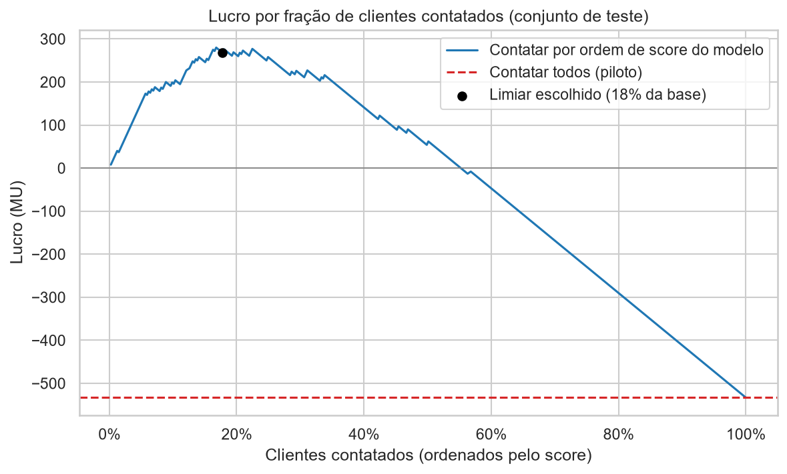
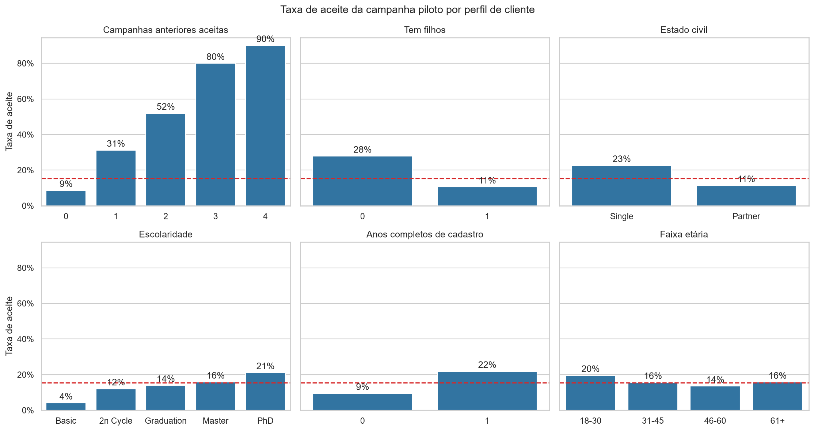
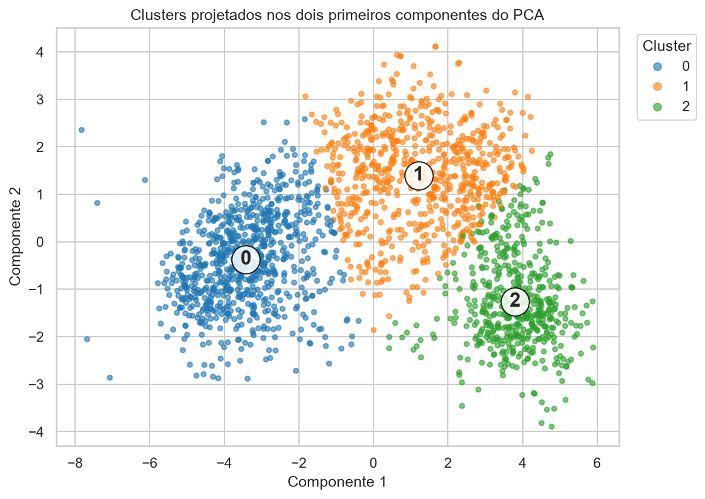
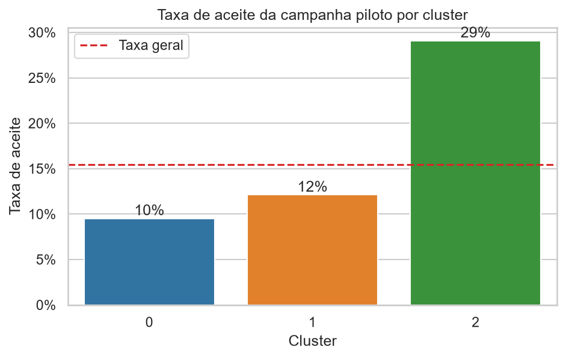
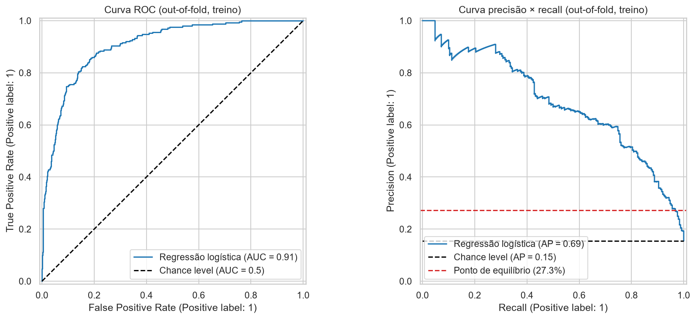

# Case iFood: segmentação de clientes e modelo de propensão para campanhas lucrativas

> Análise exploratória, segmentação com K-Means e um modelo de classificação que decide **quem contatar** numa
> campanha de marketing. Na simulação com clientes que o modelo nunca viu, a campanha passa de **prejuízo para lucro**.


📓 [Análise exploratória](notebooks/01_eda_e_tratamento.ipynb) ·
📓 [Segmentação](notebooks/02_segmentacao_clientes.ipynb) ·
📓 [Modelo e lucro](notebooks/03_modelo_propensao_e_lucro.ipynb) ·
📊 [Apresentação para o negócio](relatorios/apresentacao_resultados.pptx)

## Resultado em um minuto

Uma campanha piloto ligou para 2.240 clientes, teve 15% de aceite e **prejuízo de 3.046 MU**. Cada ligação custa
3 MU e cada aceite rende 11 MU, então só vale ligar para quem tem mais de **27% de chance** de aceitar.
O modelo estima essa chance para cada cliente.

**MU** (*monetary units*, ou unidades monetárias) é a moeda genérica usada no enunciado do case. Os valores não
estão em reais nem em dólares.

Resultado no conjunto de teste (405 clientes que não participaram do treino):

| Estratégia | Ligações | Aceites | Lucro (MU) |
|---|---:|---:|---:|
| Ligar para todos (como no piloto) | 405 | 62 | −533 |
| Sortear a mesma quantidade de clientes do modelo | 72 | 11 | −95 |
| Ligar só para o segmento de alto valor | 122 | 35 | +19 |
| **Modelo de propensão (limiar de 27%)** | **72** | **44** | **+268** |

**Para uma campanha com 2.240 clientes, o lucro estimado é de cerca de +1.480 MU** (intervalo de 90% por
*bootstrap*: 1.000 a 2.000 MU), com 82% menos ligações.



## Problema de negócio

O case de Analista de Dados do iFood simula uma empresa de varejo de alimentos que quer melhorar o retorno das
campanhas de marketing direto. O enunciado ([`referencias/case_ifood.md`](referencias/case_ifood.md)) pede:

1. Entender as características dos clientes que aceitam a oferta;
2. Criar e descrever uma segmentação de clientes com base no comportamento;
3. Construir um modelo de classificação que maximize o lucro da próxima campanha.

## Dados

- 2.240 clientes e 29 colunas: dados pessoais, gastos em seis categorias nos últimos dois anos, compras por
  canal (site, catálogo, loja) e respostas a seis campanhas ([dicionário de dados](referencias/01_dicionario_de_dados.md)).
- Base desbalanceada: 15% de aceites na campanha piloto.
- Após o tratamento: **2.023 clientes** (removidos 182 registros duplicados, 24 sem renda, 3 com idade
  inválida e 8 com renda inconsistente). Detalhes em [`dados/README.md`](dados/README.md).

## Metodologia

| Etapa | Notebook | O que foi feito |
|---|---|---|
| 1. Análise exploratória e tratamento | [01_eda_e_tratamento](notebooks/01_eda_e_tratamento.ipynb) | Remoção de duplicatas, nulos e outliers inválidos; 11 variáveis criadas (idade, tempo de cadastro, gasto total, filhos, histórico de campanhas...); perfil de quem aceitou a oferta |
| 2. Segmentação | [02_segmentacao_clientes](notebooks/02_segmentacao_clientes.ipynb) | Pré-processamento por tipo de coluna (one-hot, padronização, `PowerTransformer`, min-max); K-Means com *k* escolhido pelos métodos do cotovelo e da silhueta; visualização com PCA; descrição técnica e de negócio dos clusters |
| 3. Modelo de propensão e lucro | [03_modelo_propensao_e_lucro](notebooks/03_modelo_propensao_e_lucro.ipynb) | Comparação de modelos com validação cruzada estratificada; `GridSearchCV` (regularização *elastic net* e seleção de variáveis); comparação com e sem undersampling; curvas ROC e precisão × recall; **análise de lucro por limiar**; avaliação final em conjunto de teste; interpretação por razão de chances |

## Principais resultados

### Quem aceita a oferta



- **Histórico de campanhas é o sinal mais forte:** a taxa de aceite vai de 9% (nenhuma campanha aceita antes)
  a 90% (quatro campanhas).
- Clientes **sem filhos** (28% contra 11%), **solteiros** (23% contra 11%), com **doutorado** (21%) e **há mais
  tempo na base** (22% contra 10%) aceitam mais.
- Quem aceitou tem renda maior e **gasta 3,3 vezes mais** que quem recusou.

### Três segmentos de clientes

| Segmento | % da base | Perfil | Aceite no piloto |
|---|---:|---|---:|
| 🟦 Cluster 0 · Orçamento apertado | 40% | Renda baixa (33 mil), filhos pequenos, gasto mínimo, visitam muito o site mas compram pouco | 10% |
| 🟧 Cluster 1 · Famílias estabelecidas | 34% | Renda média (57 mil), filhos adolescentes, clientes antigos, mais sensíveis a descontos | 12% |
| 🟩 Cluster 2 · Alto valor | 26% | Renda alta (76 mil), sem filhos, maior gasto (vinhos e carnes), preferem o catálogo | 29% |

<p align="center">
  
  
</p>

O segmento de alto valor concentra quase metade dos aceites, mas sua taxa (29%) fica perto do ponto de
equilíbrio de 27%: **ligar só para ele dá lucro de apenas +19 MU no teste**. Escolher os clientes um a um,
com o modelo, rende muito mais.

### Modelo de propensão

Regressão logística com *elastic net* (`C=10`, `l1_ratio=0.25`), sem undersampling:

| Métrica | Validação cruzada (treino) | Teste |
|---|---:|---:|
| ROC-AUC | 0,91 | 0,92 |
| AUPRC (*average precision*) | 0,70 | 0,72 |
| Precisão no limiar de 27% | 59% | 61% |
| Recall no limiar de 27% | 72% | 71% |



**Variáveis mais importantes:** tempo de cadastro (+), recência da última compra (−), aceite de campanhas
anteriores (+), ser solteiro (+), escolaridade (+ para doutorado, − para básica), ter filhos (−) e compras por
catálogo (+).

## Decisões técnicas

- **Sem vazamento de dados:** a variável-alvo não entra na clusterização, e o rótulo de cluster não é usado como
  variável do modelo (o K-Means foi ajustado na base inteira).
- **Duplicatas removidas:** 8% das linhas eram cópias exatas com ID diferente. Mantê-las colocaria o mesmo
  cliente no treino e na validação e inflaria as métricas.
- **Conjunto de teste separado desde o início:** modelo, hiperparâmetros e limiar foram escolhidos só com
  validação cruzada no treino.
- **Probabilidades calibradas e limiar econômico:** sem undersampling, a regressão logística produz
  probabilidades calibradas (média prevista de 15,6% contra 15,5% real). Isso permite usar diretamente o ponto de
  equilíbrio custo ÷ receita = 3/11 ≈ 27% como limiar, muito perto do ótimo empírico (26%).
- **Métricas adequadas ao desbalanceamento:** AUPRC como métrica de otimização e `StratifiedKFold`.
- **Incerteza explícita:** intervalo de *bootstrap* para o lucro estimado.

## Como executar

```bash
git clone https://github.com/victormauricio321/case-ifood.git
cd case-ifood
python -m venv .venv
.venv\Scripts\activate          # Windows
# source .venv/bin/activate     # Linux ou macOS
pip install -r requirements.txt
```

Abra os notebooks no VS Code (extensão Jupyter) ou instale o Jupyter com `pip install jupyterlab` e rode
`jupyter lab`. No Windows, se a instalação do JupyterLab falhar por causa do limite de tamanho de caminhos,
clone o repositório numa pasta com caminho curto (por exemplo, `C:\projetos`).

Os notebooks devem ser executados em ordem (01 → 02 → 03), porque cada um gera os dados usados pelo seguinte.
Os arquivos gerados já estão no repositório, então também é possível abrir qualquer um diretamente.

**Usando o modelo treinado:**

```python
import joblib
import pandas as pd

artefato = joblib.load("modelos/modelo_propensao.joblib")
clientes = pd.read_parquet("dados/clientes_tratados.parquet").drop(columns="Response")

probabilidades = artefato["modelo"].predict_proba(clientes[artefato["colunas"]])[:, 1]
lista_de_contatos = clientes.index[probabilidades >= artefato["limiar"]]
```

## Estrutura do projeto

```
├── dados/
│   ├── README.md                     ← fonte e descrição dos arquivos
│   ├── ml_project1_data.csv          ← base original do case
│   ├── clientes_tratados.parquet     ← gerado pelo notebook 01
│   └── clientes_clusterizados.parquet← gerado pelo notebook 02
├── modelos/
│   └── modelo_propensao.joblib       ← pipeline final + limiar de decisão
├── notebooks/
│   ├── 01_eda_e_tratamento.ipynb
│   ├── 02_segmentacao_clientes.ipynb
│   ├── 03_modelo_propensao_e_lucro.ipynb
│   └── src/
│       ├── config.py                 ← caminhos e constantes (custo e receita)
│       ├── auxiliares.py             ← inspeção de outliers e coeficientes
│       ├── graficos.py               ← funções de visualização
│       └── modelos.py                ← pipelines, validação e curva de lucro
├── referencias/
│   ├── 01_dicionario_de_dados.md
│   └── case_ifood.md                 ← enunciado do case
├── relatorios/
│   ├── apresentacao_resultados.pptx  ← apresentação para stakeholders
│   └── imagens/                      ← figuras usadas neste README
├── requirements.txt
└── LICENSE
```

## Limitações e próximos passos

- O conjunto de teste tem só 62 aceites; o intervalo do *bootstrap* mostra a incerteza do lucro estimado.
- O modelo supõe que a próxima campanha se comporta como o piloto (mesma oferta, canal, custo e receita).
- Não se sabe se variáveis como `Recency` foram medidas antes ou depois do piloto, o que precisaria ser
  confirmado antes de usar o modelo em produção.
- Próximos passos: validar com teste A/B, comparar modelos de *gradient boosting* pelo lucro e reduzir
  variáveis redundantes.

## Créditos

Projeto desenvolvido durante a formação em Ciência de Dados da Hashtag Treinamentos, a partir do case público de
Analista de Dados do iFood. A estrutura de pastas é inspirada no
[Cookiecutter Data Science](https://cookiecutter-data-science.drivendata.org/).

## Autor

**Victor Maurício** · [GitHub](https://github.com/victormauricio321)
<!-- Adicione aqui o link do seu LinkedIn: · [LinkedIn](https://www.linkedin.com/in/seu-perfil) -->
